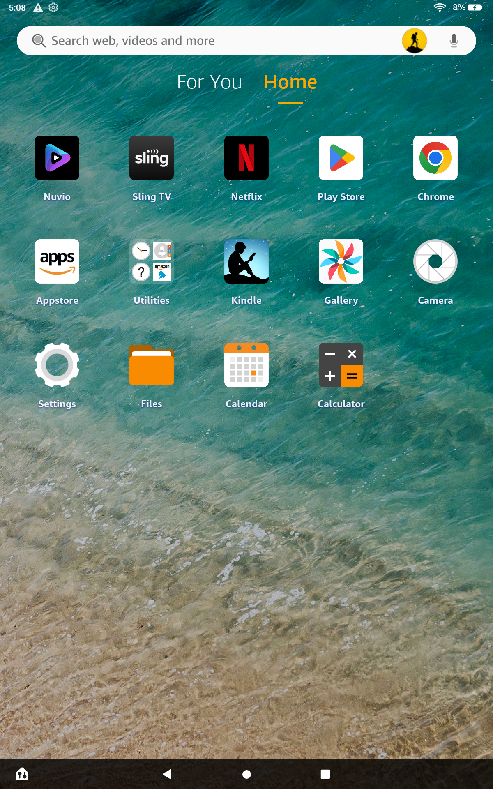
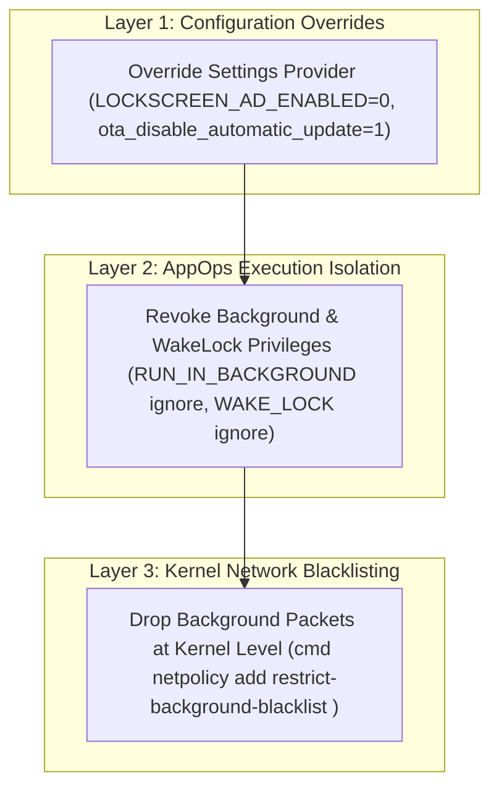
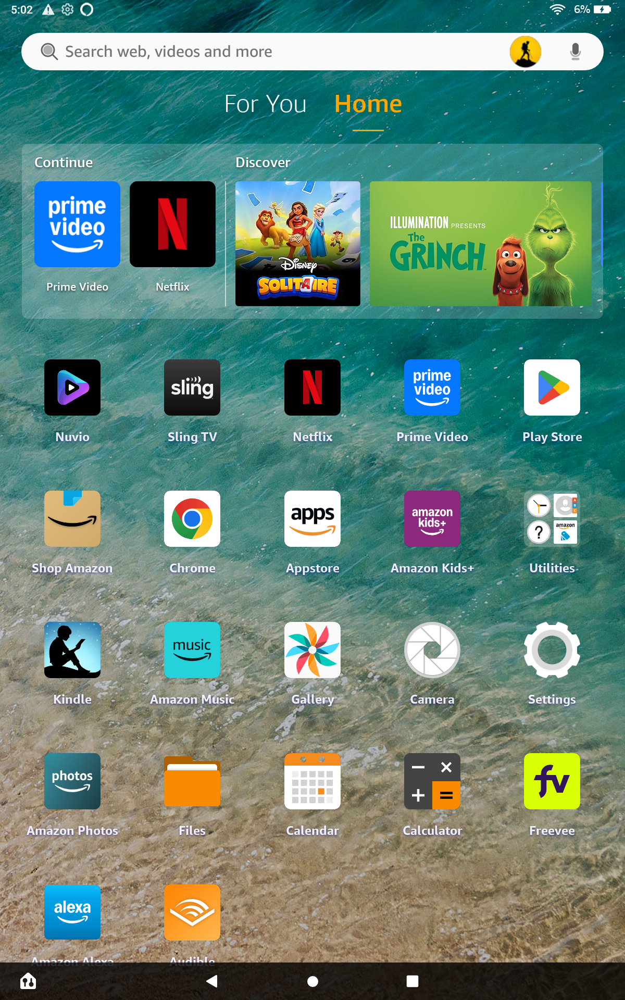

# Fire Tablet Cleaner & Optimizer

<p align="center">
  
</p>

<p align="center">
  <b>Permanent ad removal, OTA quarantine, bloatware stripping, and AOT speed compilation for Amazon Fire Tablets.</b><br>
  <i>Built to survive reboots and Amazon's background self-healing sweeps on modern Fire OS (Fire OS 7.3.2.2+, 7.3.3.x, and Fire OS 8). No root required.</i>
</p>

<p align="center">
  <a href="LICENSE"></a>
  
  
  
</p>

---

## The Problem: Why Fire Toolbox & Fire-Tools Revert

If you have tried using [Fire Toolbox](https://forum.xda-developers.com/t/windows-tool-fire-toolbox.3889604/) or [Fire-Tools](https://github.com/mrhaydendp/Fire-Tools) on a modern Fire tablet (e.g. Fire HD 10 11th Gen, Fire HD 8 10th/12th Gen, or Fire Max 11), you've likely noticed that **optimizations disappear after 24 to 48 hours**:
* Lockscreen ads suddenly reappear.
* Amazon bloatware (Alexa, Amazon Kids+, Freevee, Shop Amazon, etc.) gets re-enabled.
* The stock launcher resets its sponsored "Discover" and "Continue" rows.

### Why This Happens
In Fire OS 7.3.2.2+ and Fire OS 8, Amazon added an OS-level protected package list inside `PackageManagerService`:
```
Security exception: Cannot disable a protected package: com.amazon.kindle.kso
Security exception: Cannot disable a protected package: com.amazon.device.software.ota
Security exception: Cannot disable a protected package: com.amazon.firelauncher
Failure [DELETE_FAILED_INTERNAL_ERROR]
```
Legacy tools tried to run `pm disable-user --user 0 <pkg>` and redirected errors to `/dev/null`. Because the OTA daemons and `kso` were never truly disabled, Amazon's cloud synchronization daemon ran nightly self-healing sweeps over Wi-Fi that restored the device to its default ad-filled state.

For a full technical breakdown of the ROM framework behavior, read our [Fire OS Self-Healing Analysis](docs/fireos-self-healing-analysis.md).

---

## The Solution: 3-Layer Defense-in-Depth

Instead of fighting the protected package restriction in `PackageManagerService`, **Fire Tablet Cleaner** applies a 3-layer containment model:



1. **Layer 1 (Configuration Overrides):** Switches SystemUI keyguard out of sponsored carousel mode and halts auto-update triggers.
2. **Layer 2 (AppOps Sandboxing):** Cuts background process execution and CPU wakelocks so Amazon services cannot wake the tablet or run background jobs.
3. **Layer 3 (Kernel Network Policy):** Blacklists the UIDs of `com.amazon.kindle.kso` and `com.amazon.device.software.ota`. Android's Linux `iptables` / eBPF kernel packet filter silently drops any outgoing or incoming network packets in the background.

---

## Before & After

| Metric | Stock Fire OS 7.3.3.1 | With Fire Tablet Cleaner |
|---|---|---|
| **Free RAM** | ~950 MB | **1,360 MB (+410 MB Reclaimed)** |
| **Alexa Memory Footprint** | 123.7 MB | **0 MB (Completely Killed)** |
| **Lockscreen Ads** | Fullscreen carousels & banners | **Pristine clean wallpaper** |
| **Home Screen Clutter** | 18 Amazon apps + Discover ads | **Only your selected apps** |
| **App Execution Mode** | Uncompiled JIT (`verify`) | **Ahead-of-Time Native ARM64 (`speed`)** |

<p align="center">
  
  &nbsp;&nbsp;
  
</p>

---

## Quick Start

### Prerequisites
1. Enable **Developer Options** on your tablet:  
   * Go to **Settings > Device Options > About Fire Tablet**.
   * Tap **Serial Number** 7 times rapidly until "You are now a developer" appears.
2. Enable **USB Debugging**:  
   * Go to **Settings > Device Options > Developer Options**.
   * Turn on **USB Debugging**.
3. Connect your tablet to your computer via USB and accept the **"Allow USB Debugging"** prompt on the tablet screen.
4. Ensure [Android Platform Tools (ADB)](https://developer.android.com/tools/releases/platform-tools) is installed.

---

### Windows (PowerShell)

Open PowerShell as Administrator and run:

```powershell
# Clone the repository
git clone https://github.com/vapork/fire-tablet-cleaner.git
cd fire-tablet-cleaner

# Run all optimizations with one command
.\clean-fire-tablet.ps1 -All
```

Or run interactively to choose individual tweaks:
```powershell
.\clean-fire-tablet.ps1
```

Available flags:
* `-All`: Applies the full optimization suite.
* `-RemoveAds`: Permanently removes lockscreen ads and blacklists KSO network access.
* `-DisableOTA`: Quarantines Amazon OTA daemons to prevent self-healing sweeps.
* `-Debloat`: Disables 28 pre-installed Amazon packages.
* `-CleanHome`: Removes the sponsored Discover and Continue rows from the stock home screen.
* `-CompileAOT`: Compiles user apps directly to 64-bit native ARM machine code.
* `-Restore`: Restores factory settings and re-enables all Amazon bloatware.

---

### macOS & Linux (Bash)

Open Terminal and run:

```bash
# Clone the repository
git clone https://github.com/vapork/fire-tablet-cleaner.git
cd fire-tablet-cleaner

# Make executable and run
chmod +x clean-fire-tablet.sh
./clean-fire-tablet.sh --all
```

Or run interactively:
```bash
./clean-fire-tablet.sh
```

---

## What Gets Debloated

The script reads from [`packages/debloat-list.txt`](packages/debloat-list.txt) which safely removes:
* **Shopping & Commercial:** Shop Amazon (`com.amazon.windowshop`), Device Sales promotions.
* **Media & Streaming:** Amazon Music (`com.amazon.mp3`), Amazon Photos (`com.amazon.photos`), Freevee (`com.amazon.imdb.tv.mobile.app`), Audible (`com.audible.application.kindle`), Prime Video (`com.amazon.avod`).
* **Kids & Clutter:** Amazon Kids+ (`com.amazon.tahoe`), Kids Communication, Silk Kids Sandbox, GameCircle.
* **Alexa & Speech:** Amazon Alexa (`com.amazon.dee.app`), Alexa Speech Interaction (`amazon.speech.sim`), H2 Voice Client, Spotlight recommendations.
* **Telemetry & Tracking:** Diagnostic loggers, wireless metrics, device telemetry, advertising ID sync daemons.

*Note: Essential system components (Google Play Services, Camera, Gallery, Settings, Files, Calendar, Calculator, Wi-Fi, Bluetooth) are completely untouched.*

---

## Verified Devices

* **Amazon Fire HD 10 (11th Gen, 2021 - `trona` / `KFTRWI`)** - Fire OS 7.3.3.1 (Tested & Verified)
* **Amazon Fire HD 8 (10th / 12th Gen)** - Fire OS 7.3.x / Fire OS 8
* **Amazon Fire 7 (9th / 12th Gen)** - Fire OS 7.3.x / Fire OS 8
* **Amazon Fire Max 11 (13th Gen)** - Fire OS 8.3.x

---

## License

Released under the [MIT License](LICENSE). Contributions, issues, and feature requests are welcome!
